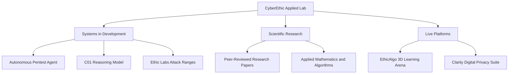

# CyberEthic Applied AI & Security Lab

**Autonomous Offensive Pentest Agents &bull; Specialized Cybersecurity Reasoning Models &bull; Hands-On Attack Labs**

[**Website**](https://cyberethic.in) &bull; [**EthicAlgo**](https://algo.cyberethic.in) &bull; [**Clarity**](https://clarity.cyberethic.in) &bull; [**Careers**](https://careers.cyberethic.in)

CyberEthic is an applied research lab and product company. Rather than simply building software, we solve fundamental computing and security challenges: conducting core research into how AI reasons over vulnerabilities, securing model architectures under adversarial conditions, and exploring low-level operating system internals. Our discoveries are released as high-performance open-source primitives, our autonomous products actively find and verify real-world zero-day CVEs, and our research papers are cited by scientists and researchers globally.

---

---

### Operational Pillars

Our organization operates across three distinct yet synergistic pillars:

* **Scientific & Academic Research**  
  We conduct fundamental, independent research at the frontier of applied mathematics, neural reasoning, and systems security. Our research remains academically rigorous, independent of commercial product cycles, and cited by scientists and researchers globally.

* **Open-Source Ecosystem**  
  We engineer high-performance security-focused algorithms, core security libraries, and practical offensive and defensive tools. These are modular primitives built for industrial scale and released openly so developers and security researchers can integrate them directly into their own systems.

* **Production Platforms**  
  We translate scientific breakthroughs into end-to-end, production-grade systems. This spans autonomous vulnerability testing agents, specialized cybersecurity reasoning models, interactive 3D learning ecosystems (**EthicAlgo**), and digital privacy platforms (**Clarity**).

---

### What We Are Building

* **[Autonomous Penetration Testing Agent](https://cyberethic.in/#pathways)** `[In Development]`  
  We are building AI agents that test web applications the way human penetration testers do. They explore attack graphs, coordinate multi-agent probing, and verify exploits in a deterministic sandbox with automated fix synthesis.

* **[Cybersecurity Reasoning Model (C01)](https://cyberethic.in/#pathways)** `[In Training]`  
  General LLMs refuse legitimate security tasks or generate unreliable payloads. We are engineering C01 from the ground up: trained on 120,000+ official CVE advisories, 50,000+ verified exploit proofs, assembly decompilations, and binary call graphs for rigorous vulnerability reasoning.

* **[Ethic Labs](https://cyberethic.in/#pathways)** `[In Development]`  
  Interactive ethical hacking labs and live virtual targets. Practice Active Directory lateral movement, AI red teaming, and rapid 2-hour zero-day CVE reproductions directly in your browser.

* **[EthicAlgo](https://algo.cyberethic.in)** `[Live]`  
  Interactive 3D DSA and System Design learning platform. Explore algorithms with 3D spatial visualizers, learn theory in both English and Hinglish, practice FAANG/MAANG and product/service company mock interviews, and compete in multiplayer 1v1 or 4-player custom matchmaking rooms.

* **[Clarity](https://clarity.cyberethic.in)** `[Live]`  
  Digital privacy and asset protection platform providing image privacy verification, facial indexing detection, and automated DMCA monitoring.

---

### Activity & Community

---

### Careers

We are always looking for exceptional security researchers, AI systems engineers, and mathematicians:

* **Explore Open Roles:** [careers.cyberethic.in](https://careers.cyberethic.in)
* **Careers Inquiries:** [careers@cyberethic.in](mailto:careers@cyberethic.in)

---

### Connect & Collaborate

* **General Inquiries:** [contact@cyberethic.in](mailto:contact@cyberethic.in)
* **Founder:** [founder@cyberethic.in](mailto:founder@cyberethic.in)
* **Partnerships & Community:** [community@cyberethic.in](mailto:community@cyberethic.in)
* **Security Disclosures:** [security@cyberethic.in](mailto:security@cyberethic.in)

  <a href="https://cyberethic.in"><b>Website</b></a> &bull;
  <a href="https://github.com/cyberethicc"><b>GitHub</b></a> &bull;
  <a href="https://linkedin.com/company/cyberethicc"><b>LinkedIn</b></a> &bull;
  <a href="https://x.com/cyberethicc"><b>X / Twitter</b></a>

---

  <b>&copy; 2026 CyberEthic Applied AI Security Lab</b> &bull; Researched in India, refined in San Francisco, deployed globally.

